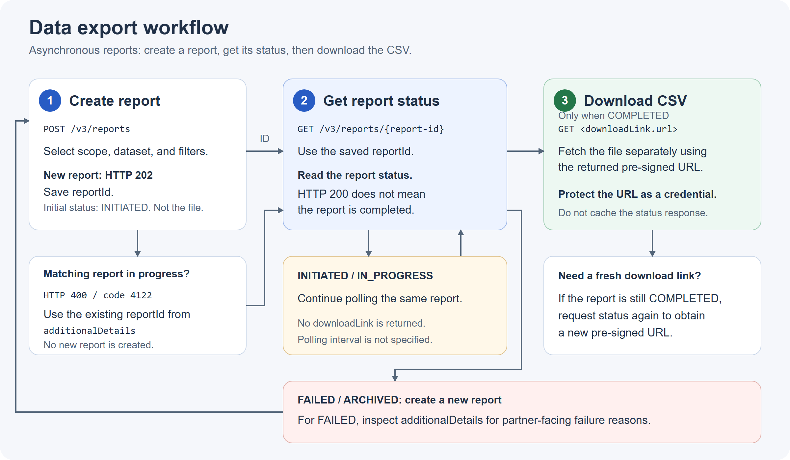

# Data exports

Data exports provide an asynchronous way to retrieve data across a partner's resellers as a downloadable report. Reports currently support the propensity dataset, with churn and seat expansion report types. Each report contains a single dataset.

## Export workflow

Use the following workflow to create and download a data export:

1. **Create report:** Select the dataset, scope, and applicable filters. The service accepts the request and returns a `reportId` for the report instead of the generated file.
2. **Get report status:** Use the `reportId` to check the report status until processing is complete.
3. **Download report:** When the report status is `COMPLETED`, retrieve the CSV file using `downloadLink.url`.

All exports are asynchronous, including small exports. Use the list operation to find previous reports or check for work already in progress. For endpoints, request fields, and examples, see [Manage data exports using APIs](./apis.md).

## Scope and access

The report scope determines whether the export includes data across all resellers or specific resellers.

Partner identity is determined by authentication rather than by a partner identifier in the request. Partners can view only their own reports.

Set `scope.level` to `partner` to export the authenticated partner's data across resellers, or set it to `reseller` with one or more reseller IDs in `scope.ids`. Invalid reseller IDs and reseller IDs that do not belong to the authenticated partner are skipped and contribute no rows. The service does not return a reseller-recognition error for these IDs. They do not provide access to another partner's data. For partner scope, `scope.ids` is ignored.

Each report response includes a read-only `source` field. The value is `API` for reports created through a partner integration and `Bridge` for reports created through the Bridge UI. Do not include `source` in a create report request.

## Report contents

The selected dataset determines the available filters and the contents of the resulting file. Reports are UTF-8 CSV files with a header row and one row per customer. See [Report file format](./apis.md#report-file-format) for the columns and probability-filter behavior.

## Report lifecycle

The API returns the following report states:

| State | Meaning | Next action |
|---|---|---|
| `INITIATED` | The request has been accepted, but processing has not yet started. | Check the status of the existing report. |
| `IN_PROGRESS` | The export is being generated. | Continue checking the status of the existing report. |
| `COMPLETED` | The export is ready, and the status operation returns `downloadLink`. The report transitions to `ARCHIVED` when retention ends. | Download the file while it is retained. |
| `FAILED` | The export could not be completed. | Submit a new request to attempt the export again. |
| `ARCHIVED` | The retention period has ended, and the file is no longer available. | Submit a new export request. The old file cannot be revived. |

A successful status does not necessarily indicate that report generation succeeded. HTTP `200` with `status: "FAILED"` means the status request succeeded but report generation failed. Partner-facing failure reasons are returned in `additionalDetails`. See [Error codes for data exports](./error-codes.md).

## Repeated requests and report creation

Before creating a report, the service checks for a matching request for the authenticated partner. The response depends on the state of the existing matching report.

| Matching report state | Create response |
|---|---|
| `INITIATED` or `IN_PROGRESS` | HTTP `400`, code `4122`, with the existing `reportId` in `additionalDetails`. No new report is created. |
| `COMPLETED`, `FAILED`, or `ARCHIVED` | HTTP `202`. A new report is created. |
| No matching report | HTTP `202`. A new report is created. |

A request is considered a match based on the authenticated partner and the normalized request body. During normalization, the service ignores JSON field and array order, removes duplicate array values, and applies default values before comparison. `scope.ids` is ignored for partner scope. See [Duplicate request handling](./apis.md#duplicate-request-handling).

## Download links and retention

The status operation returns `downloadLink` only for `COMPLETED` reports. The `url` is a short-lived pre-signed URL, and `expiresAt` specifies the UTC time when the URL expires.

Request the report status again using the same `reportId` to get a new download link to the retained file while the report remains `COMPLETED`. Download link expiry does not affect report retention or cause the report to transition to `ARCHIVED`. Protect pre-signed URLs as credentials and do not cache the completed status response.

Report retention begins when processing completes and is independent of download link expiry:

| Report type | Retention |
|---|---|
| `churn` | 1 month |
| `seat_expansion` | 7 days |

After retention ends, the report becomes `ARCHIVED`. Create a new report to obtain fresh data.

## What's next?

- [Manage data exports using APIs](./apis.md)
- [Error codes for data exports](./error-codes.md)
